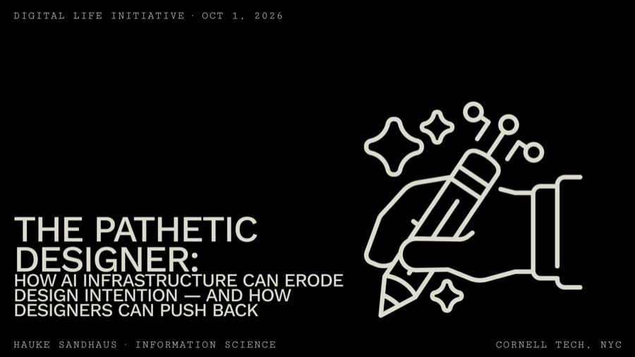

New talk on fresh work: _The Pathetic Designer: How AI Infrastructure Can Erode Design Intention — and How Designers Can Push Back_ at the [Digital Life Initiative](https://www.dli.tech.cornell.edu/) on October 1. The long version, _AI and Design Autonomy_, runs twice this fall as a guest lecture in HCI and Design (INFO 6410 / CS 5682). [Slides for both](/teaching/#invited-talks) are on the talks page.
